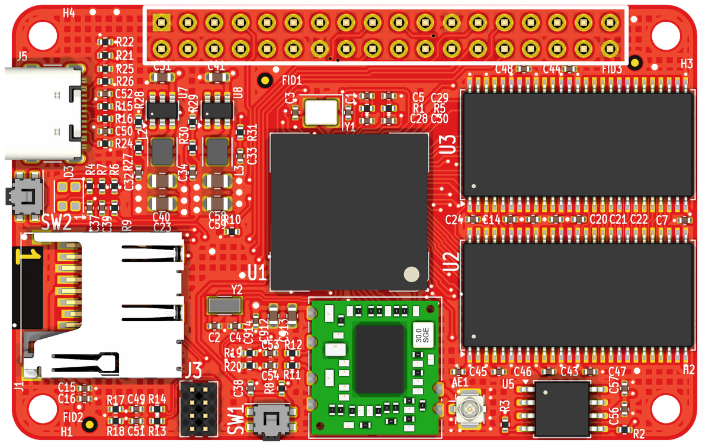

# Glasnost M9G10

A small open-hardware Linux board built around the Microchip AT91SAM9G10 processor, for IoT and embedded projects. It boots Linux from a microSD card, has WiFi on board, and brings UART, I²C, SPI and GPIO out to a header for capes and your own circuits.

**Status:** revision 2.0 — working hardware, documentation in progress. See [known issues](https://github.com/vd-rd/sbc_at91sam9g10/issues).

## Specifications

| | |
|---|---|
| Processor | Microchip AT91SAM9G10, ARM926EJ-S at 266 MHz |
| Memory | 64 MB SDRAM (2× 256 Mbit) by default; up to 128 MB with 2× 512 Mbit chips |
| Storage | microSD card (boot and root filesystem); 2 MB SPI DataFlash (data only, not bootable) |
| USB | USB-C port (power in, USB device, recovery); one USB host port on a 1.27 mm header for a cape |
| Wireless | WiFi (RTL8188CUS module, U.FL antenna connector) by default; WiFi/Bluetooth with a compatible USB module |
| Expansion | 2×18 main header (2.54 mm): debug console, 2 more UARTs, I²C, SPI, 4 GPIO, reset, 3.3 V |
| Power | 5 V through the USB-C port |
| Size | 66 × 42 mm |
| Software | Linux (mainline kernel with a board device tree), AT91Bootstrap, U-Boot |
| Design files | KiCad 10 (`hardware/`) |

> [!NOTE]
> The processor's boot ROM only reads standard-capacity microSD cards (SDSC, **up to 2 GB**) when it boots directly from the card.

## Documentation

Full documentation — getting started, pinouts, power, boot and recovery, build your own — is in [`docs/`](docs/) and published at **https://vd-rd.github.io/sbc_at91sam9g10**.

## Repository

| Path | Contents |
|---|---|
| `hardware/` | KiCad 10 project (schematics, PCB) |
| `docs/` | Documentation site sources |
| `resources/` | Datasheets and reference documents ([list](resources/REFERENCES.md)) |

Fabrication files are attached to [releases](https://github.com/vd-rd/sbc_at91sam9g10/releases).

Glasnost is a family of boards and capes — see the [Glasnost catalogue](https://vd-rd.github.io/glasnost.iot/catalogue/).

## License

Open hardware (community design, not certified).
